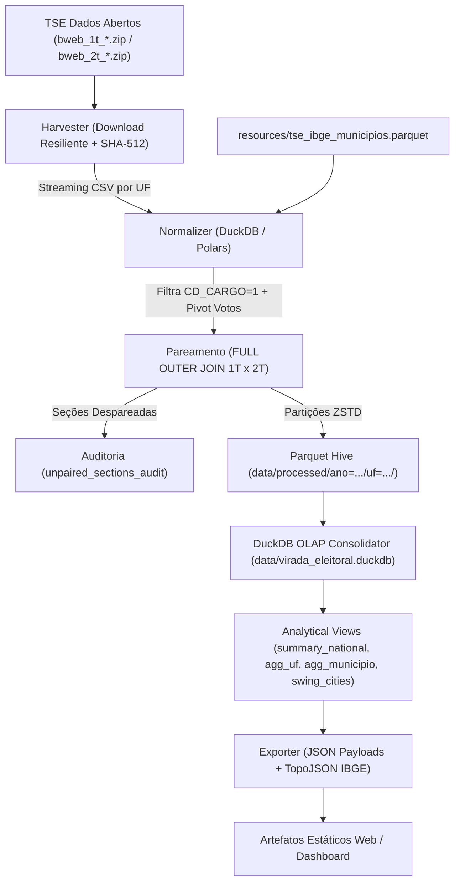

# virada_eleitoral: Pipeline Analítico de Viradas Eleitorais Presidenciais

[](https://www.python.org/)
[](http://mypy-lang.org/)
[](https://github.com/astral-sh/ruff)
[](https://docs.pytest.org/)
[](https://pytest-cov.readthedocs.io/)

Plataforma de alta performance para auditoria técnica, processamento de Boletins de Urna (BUs) e mapeamento cartográfico de reversões de resultado (*viradas*) nas eleições presidenciais brasileiras (com foco primário nas Eleições Gerais de 2022).

O sistema processa determinística e exaustivamente as ~470.000 a 500.000 seções eleitorais do país (~40 milhões de linhas de registros), pareando o 1º e o 2º turno para quantificar variações nominais, pontos percentuais, absorção de votos de terceiros candidatos e cidades pêndulo (*swing cities*).

---

## 1. Arquitetura e Fluxo de Dados

O projeto segue estritamente o protocolo **AI-Native Spec-Driven Development (SDD)**:



---

## 2. Instalação e Ambiente

O projeto é gerenciado exclusivamente via **Astral `uv`**:

```bash
# Sincronizar dependências e criar ambiente virtual
uv sync

# Ativar ambiente de desenvolvimento com ferramentas de verificação
uv sync --all-extras
```

---

## 3. Uso da Interface de Linha de Comando (`virada`)

A ferramenta de linha de comando modular oferece subcomandos para cada fase do pipeline:

### 3.1. Pipeline Completo (`run-all`)
Executa sequencialmente normalização, consolidação, exportação e verificação:
```bash
uv run virada run-all --ano 2022 --uf ALL --raw-dir data/raw --db-path data/virada_eleitoral.duckdb --export-dir data/export
```

### 3.2. Subcomandos Modulares
- **Coleta e Integridade:**
  ```bash
  uv run virada harvest --ano 2022 --input-dir data/raw --manifest-dir data/raw
  ```
- **Normalização e Pareamento 1T x 2T:**
  ```bash
  uv run virada normalize --ano 2022 --uf ALL --raw-dir data/raw --processed-dir data/processed
  ```
- **Consolidação DuckDB OLAP:**
  ```bash
  uv run virada consolidate --ano 2022 --processed-dir data/processed --db-path data/virada_eleitoral.duckdb
  ```
- **Exportação JSON e GeoJSON:**
  ```bash
  uv run virada export --ano 2022 --db-path data/virada_eleitoral.duckdb --out-dir data/export
  ```
- **Auditoria Formal de Invariantes (DoD):**
  ```bash
  uv run virada verify --db-path data/virada_eleitoral.duckdb --export-dir data/export
  ```

---

## 4. Classificação Formal de Viradas

Cada seção eleitoral é classificada deterministicamente com base na votação entre os turnos:

| Classificação | Condição Matemática |
| :--- | :--- |
| `VIRADA_LULA` | Votos Lula 1T < Votos Adv 1T **E** Votos Lula 2T > Votos Adv 2T |
| `VIRADA_ADVERSARIO` | Votos Lula 1T > Votos Adv 1T **E** Votos Lula 2T < Votos Adv 2T |
| `MANTEVE_LIDERANCA` | Votos Lula 1T > Votos Adv 1T **E** Votos Lula 2T > Votos Adv 2T |
| `MANTEVE_DESVANTAGEM` | Votos Lula 1T < Votos Adv 1T **E** Votos Lula 2T < Votos Adv 2T |
| `EMPATE` | Igualdade de votos em qualquer um dos turnos |

---

## 5. Portão de Verificação Automático (*Verification Gate*)

Para assegurar 100% de conformidade com os requisitos de auditoria, execute os testes e linters:

```bash
# 1. Verificação de estilo e PEP 8
uv run ruff check src tests

# 2. Verificação de formatação
uv run ruff format --check src tests

# 3. Tipagem estática rigorosa
uv run mypy --strict src

# 4. Suíte de testes com cobertura mínima de 90%
uv run pytest -q --cov=virada_eleitoral --cov-fail-under=90
```

---

## 6. Estrutura do Repositório

```text
virada_eleitoral/
├── AGENTS.MD                           # Governança de agentes, padrões e protocolo SDD
├── specs.md                            # Especificação mestra, fórmulas analíticas e índice de requisitos
├── specs/                              # Especificações técnicas executáveis e detalhadas
│   ├── 01-harvesting-and-manifest.md   # Obtenção de BUs TSE, integridade SHA-512 e streaming
│   ├── 02-normalization-and-pairing.md # Filtragem presidencial, pareamento 1T x 2T e seções agregadas
│   ├── 03-analytics-and-turnover-metrics.md # Deltas, margens líquidas, classificação e DuckDB OLAP
│   ├── 04-export-geojson-and-web.md    # TopoJSON/GeoJSON IBGE, payloads estáticos e DuckDB-Wasm
│   └── 05-testing-fixtures-and-roadmap.md # Fixtures FX-01..FX-10, BDD/Gherkin, CLI e roadmap atômico
├── src/
│   └── virada_eleitoral/
│       ├── cli.py                      # CLI unificada (typer) com subcomandos modulares
│       ├── config.py                   # Configurações tipadas via Pydantic Settings
│       ├── contracts/                  # Contratos imutáveis e schemas Pydantic v2
│       ├── harvester/                  # Coleta resiliente local e remota (SHA-512)
│       ├── normalizer/                 # Filtragem presidencial, pivot e pareamento 1T x 2T
│       ├── analytics/                  # Motor analítico, métricas e DuckDbConsolidator OLAP
│       ├── export/                     # Exportação JSON estático, GeoJSON e DuckDB-Wasm
│       └── resources.py                # De-Para canônico de códigos TSE e IBGE
├── resources/
│   └── tse_ibge_municipios.parquet     # 5.570 municípios mapeados com O(1) lookup
└── tests/
    ├── fixtures/                       # Gerador determinístico de fixtures áureas (FX-01 a FX-10)
    ├── unit/                           # Testes unitários para 100% dos módulos
    ├── integration/                    # Testes de integração de pipeline fim-a-fim
    └── property/                       # Testes de propriedades e invariantes (Hypothesis)
```
