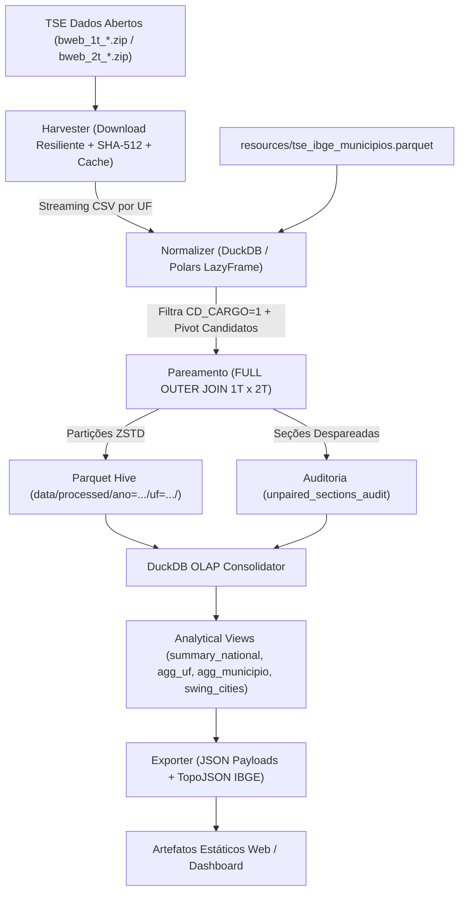

# SPECS.MD: Especificação Técnica Mestra e Arquitetura do Sistema

## 1. Escopo, Objetivos e Matriz de Requisitos
Construir uma infraestrutura analítica de alta performance, auditável, reproduzível, multiplataforma (Windows/Linux/macOS) e baseada em processamento streaming para analisar os Boletins de Urna (BUs) de ambos os turnos das Eleições Presidenciais brasileiras (com foco primário nas Eleições Gerais de 2022 — ~470.000 a 500.000 seções eleitorais e mais de 40 milhões de linhas de registros brutos).

O objetivo central é quantificar a dinâmica da virada eleitoral entre turnos, identificando formalmente a geografia da reversão de votos a favor do candidato Luiz Inácio Lula da Silva frente ao seu oponente (Jair Bolsonaro), a absorção de votos de terceiros colocados e abstenções, consolidando resultados nos três níveis hierárquicos: Nacional/UF, Município e Seção Eleitoral.

---

### 1.1. Matriz de Requisitos de Alto Nível

| ID | Domínio | Requisito Resumido | Especificação Detalhada |
| :--- | :--- | :--- | :--- |
| `REQ-HARV-01` | Ingestão / Coleta | Obtenção streaming e gerência de pacotes de Boletins de Urna (`bweb_1t_*.csv` e `bweb_2t_*.csv`) do Portal de Dados Abertos do TSE via download resiliente ou cache local. | [`specs/01-harvesting-and-manifest.md`](./specs/01-harvesting-and-manifest.md) |
| `REQ-HARV-02` | Integridade | Validação criptográfica de integridade de arquivo (`SHA-512`), controle de idempotência e manifesto formal de artefatos processados. | [`specs/01-harvesting-and-manifest.md`](./specs/01-harvesting-and-manifest.md) |
| `REQ-NORM-01` | Normalização | Filtragem estrita do cargo Presidente (`CD_CARGO == 1`), pivotagem colunar de candidatos e enriquecimento com tabela De-Para TSE/IBGE de 7 dígitos. | [`specs/02-normalization-and-pairing.md`](./specs/02-normalization-and-pairing.md) |
| `REQ-NORM-02` | Pareamento | Algoritmo de `FULL OUTER JOIN` sobre a chave canônica `(SG_UF, CD_MUNICIPIO, NR_ZONA, NR_SECAO)` entre 1º e 2º turnos sem distorção estatística. | [`specs/02-normalization-and-pairing.md`](./specs/02-normalization-and-pairing.md) |
| `REQ-NORM-03` | Auditoria de Seções | Detecção e rastreabilidade integral de urnas de contingência, agregadas ou ausentes em um dos turnos gravadas em `unpaired_sections_audit`. | [`specs/02-normalization-and-pairing.md`](./specs/02-normalization-and-pairing.md) |
| `REQ-ANAL-01` | Armazenamento | Persistência colunar em Parquet particionado (`ZSTD`) e consolidação idempotente em banco analítico DuckDB (`<= 150 MB`). | [`specs/03-analytics-and-turnover-metrics.md`](./specs/03-analytics-and-turnover-metrics.md) |
| `REQ-ANAL-02` | Fórmulas Analíticas | Cálculo exato de deltas nominais, deltas em pontos percentuais (`pp`), margem líquida e classificação categórica quádrupla de virada. | [`specs/03-analytics-and-turnover-metrics.md`](./specs/03-analytics-and-turnover-metrics.md) |
| `REQ-ANAL-03` | Migração de Votos | Modelagem da absorção de votos de terceiros colocados (Simone Tebet, Ciro Gomes, outros), brancos, nulos e abstenções do 1T para o 2T. | [`specs/03-analytics-and-turnover-metrics.md`](./specs/03-analytics-and-turnover-metrics.md) |
| `REQ-EXPO-01` | Contratos JSON | Exportação determinística de payloads JSON estáticos validados por modelos Pydantic v2 para consumo em visualizadores web. | [`specs/04-export-geojson-and-web.md`](./specs/04-export-geojson-and-web.md) |
| `REQ-EXPO-02` | Cartografia IBGE | Cruzamento geográfico e fusão com malha territorial IBGE (GeoJSON/TopoJSON simplificado) para mapas temáticos de calor e virada. | [`specs/04-export-geojson-and-web.md`](./specs/04-export-geojson-and-web.md) |
| `REQ-QA-01` | Qualidade / SDD | Suíte de testes `pytest` cobrindo 10 fixtures áureas (`FX-01` a `FX-10`), testes de invariantes e CLI unificada (`virada`). | [`specs/05-testing-fixtures-and-roadmap.md`](./specs/05-testing-fixtures-and-roadmap.md) |

---

## 2. Semântica Eleitoral e Regras de Negócio Fundamentais

### 2.1. Chave Canônica de Pareamento
A unidade atômica territorial e soberana de auditoria é a **Seção Eleitoral**, identificada exclusivamente pela tupla quádrupla:
$$\text{PK} = (\text{SG\_UF}, \text{CD\_MUNICIPIO}, \text{NR\_ZONA}, \text{NR\_SECAO})$$

- `SG_UF`: Sigla da Unidade Federativa (2 caracteres maiúsculos: 26 estados + `DF` + `ZZ` para votação no exterior).
- `CD_MUNICIPIO`: Código de município adotado pela Justiça Eleitoral (TSE), com 5 dígitos numéricos.
- `NR_ZONA`: Número da Zona Eleitoral.
- `NR_SECAO`: Número da Seção Eleitoral.

### 2.2. Definições e Fórmulas de Métricas Analíticas
Para cada entidade territorial (Seção, Município, UF ou Brasil) e turnos $T \in \{1, 2\}$:

1. **Votos Válidos ($V_T$):** Total de votos nominais em candidatos habilitados:
   $$V_T = \text{Votos}_{\text{Lula}, T} + \text{Votos}_{\text{Adversário}, T} + \text{Votos}_{\text{Outros}, T}$$
   *(No 2º turno, $\text{Votos}_{\text{Outros}, 2T} = 0$ por definição regulamentar).*

2. **Percentual de Votos Válidos ($P_{C, T}$):**
   $$P_{C, T} = \frac{\text{Votos}_{C, T}}{V_T} \times 100$$
   *(Calculado estritamente com tratamento de divisão por zero: `COALESCE(votos * 100.0 / NULLIF(v_validos, 0), 0.0)`).*

3. **Delta Nominal de Lula ($\Delta \text{Votos}_{13}$):**
   $$\Delta \text{Votos}_{13} = \text{Votos}_{13, 2T} - \text{Votos}_{13, 1T}$$

4. **Delta em Pontos Percentuais ($\Delta PP_{13}$):**
   $$\Delta PP_{13} = P_{13, 2T} - P_{13, 1T}$$

5. **Margem Líquida ($M_T$) e Delta de Margem ($\Delta M$):**
   $$M_T = \text{Votos}_{13, T} - \text{Votos}_{\text{Adv}, T}$$
   $$\Delta M = M_{2T} - M_{1T}$$

6. **Classificação Categórica do Resultado:**
   Avaliada comparando os votos do candidato Lula (13) frente ao adversário (22) em cada turno:
   - **`VIRADA_LULA`:** $\text{Votos}_{13, 1T} < \text{Votos}_{\text{Adv}, 1T}$ E $\text{Votos}_{13, 2T} > \text{Votos}_{\text{Adv}, 2T}$.
   - **`VIRADA_ADVERSARIO`:** $\text{Votos}_{13, 1T} > \text{Votos}_{\text{Adv}, 1T}$ E $\text{Votos}_{13, 2T} < \text{Votos}_{\text{Adv}, 2T}$.
   - **`MANTEVE_LIDERANCA`:** $\text{Votos}_{13, 1T} > \text{Votos}_{\text{Adv}, 1T}$ E $\text{Votos}_{13, 2T} > \text{Votos}_{\text{Adv}, 2T}$.
   - **`MANTEVE_DESVANTAGEM`:** $\text{Votos}_{13, 1T} < \text{Votos}_{\text{Adv}, 1T}$ E $\text{Votos}_{13, 2T} < \text{Votos}_{\text{Adv}, 2T}$.
   - *(Em empates exatos $\text{Votos}_{13} == \text{Votos}_{\text{Adv}}$, registra-se `EMPATE_1T` ou `EMPATE_2T`).*

7. **Taxa de Absorção de Terceiros Candidatos e Abstenções:**
   - Em cada município/seção, quantifica-se a disponibilidade de votos de 3ºs colocados no 1T:
     $$\text{Pool}_{\text{Disponível}} = \text{Votos}_{\text{Outros}, 1T} + \Delta \text{Comparecimento}$$
   - Eficiência de Atração de Lula:
     $$\text{Eficiência}_{13} = \frac{\Delta \text{Votos}_{13}}{\max(1, \text{Votos}_{\text{Outros}, 1T})}$$

---

## 3. Insumos Primários dos Boletins de Urna (TSE)

Os dados provêm dos arquivos oficiais de votação nominal por seção do TSE (`bweb_1t_{UF}_*.csv` e `bweb_2t_{UF}_*.csv`), contendo codificação `ISO-8859-1` e separador `;`:

| Coluna Original TSE | Tipo de Dado | Descrição e Uso no Pipeline |
| :--- | :--- | :--- |
| `SG_UF` | `VARCHAR(2)` | Sigla do Estado (`SP`, `MG`, ..., `ZZ`). |
| `CD_MUNICIPIO` | `INTEGER` | Código do município no TSE (5 dígitos). |
| `NM_MUNICIPIO` | `VARCHAR(120)`| Nome oficial do município. |
| `NR_ZONA` | `SMALLINT` | Número da Zona Eleitoral. |
| `NR_SECAO` | `SMALLINT` | Número da Seção Eleitoral. |
| `CD_CARGO` | `TINYINT` | Código do cargo em disputa (`1` = Presidente). |
| `NR_VOTAVEL` | `INTEGER` | Número do candidato (`13` Lula, `22` Bolsonaro, outros, `95` Branco, `96` Nulo). |
| `QT_VOTOS` | `INTEGER` | Quantidade de votos apurados naquela linha. |
| `QT_APTOS` | `INTEGER` | Quantidade de eleitores aptos na seção. |
| `QT_COMPARECIMENTO`| `INTEGER` | Total de eleitores que compareceram à urna. |
| `QT_ABSTENCAO` | `INTEGER` | Total de eleitores que se abstiveram. |

---

## 4. Arquitetura de Dados Colunar e DDL do DuckDB

### 4.1. Tabela Granular de Seções Pareadas (`pair_sections`)
Consolidada no DuckDB com chave primária composta:

```sql
CREATE TABLE pair_sections (
    ano_eleicao SMALLINT NOT NULL,
    sg_uf VARCHAR(2) NOT NULL,
    cd_municipio INTEGER NOT NULL,
    cd_municipio_ibge INTEGER,                   -- Enriquecido via De-Para (7 dígitos)
    nm_municipio VARCHAR(120) NOT NULL,
    nr_zona SMALLINT NOT NULL,
    nr_secao SMALLINT NOT NULL,
    status_pareamento VARCHAR(20) NOT NULL,      -- 'PAREADA_AMBOS', 'APENAS_1T', 'APENAS_2T'
    
    -- Turno 1
    aptos_1t INTEGER,
    comparecimento_1t INTEGER,
    abstencao_1t INTEGER,
    votos_validos_1t INTEGER,
    votos_lula_1t INTEGER NOT NULL DEFAULT 0,
    votos_adv_1t INTEGER NOT NULL DEFAULT 0,
    votos_outros_1t INTEGER NOT NULL DEFAULT 0,
    votos_brancos_1t INTEGER NOT NULL DEFAULT 0,
    votos_nulos_1t INTEGER NOT NULL DEFAULT 0,
    pct_lula_1t DOUBLE NOT NULL DEFAULT 0.0,
    pct_adv_1t DOUBLE NOT NULL DEFAULT 0.0,
    
    -- Turno 2
    aptos_2t INTEGER,
    comparecimento_2t INTEGER,
    abstencao_2t INTEGER,
    votos_validos_2t INTEGER,
    votos_lula_2t INTEGER NOT NULL DEFAULT 0,
    votos_adv_2t INTEGER NOT NULL DEFAULT 0,
    votos_brancos_2t INTEGER NOT NULL DEFAULT 0,
    votos_nulos_2t INTEGER NOT NULL DEFAULT 0,
    pct_lula_2t DOUBLE NOT NULL DEFAULT 0.0,
    pct_adv_2t DOUBLE NOT NULL DEFAULT 0.0,
    
    -- Métricas Analíticas de Virada
    delta_votos_lula INTEGER NOT NULL DEFAULT 0,
    delta_votos_adv INTEGER NOT NULL DEFAULT 0,
    delta_pp_lula DOUBLE NOT NULL DEFAULT 0.0,
    delta_pp_adv DOUBLE NOT NULL DEFAULT 0.0,
    margem_1t INTEGER NOT NULL DEFAULT 0,
    margem_2t INTEGER NOT NULL DEFAULT 0,
    delta_margem INTEGER NOT NULL DEFAULT 0,
    delta_abstencao INTEGER NOT NULL DEFAULT 0,
    classificacao_virada VARCHAR(30) NOT NULL,    -- 'VIRADA_LULA', 'VIRADA_ADVERSARIO', 'MANTEVE_LIDERANCA', 'MANTEVE_DESVANTAGEM'
    eficiencia_absorcao_outros DOUBLE,
    
    PRIMARY KEY (ano_eleicao, sg_uf, cd_municipio, nr_zona, nr_secao)
);
```

### 4.2. Tabela de Auditoria de Seções Não-Pareadas (`unpaired_sections_audit`)
Registra seções com contingência, quebra de urna, agregação ou seções prisionais/itinerantes existentes em apenas um dos turnos:

```sql
CREATE TABLE unpaired_sections_audit (
    ano_eleicao SMALLINT NOT NULL,
    sg_uf VARCHAR(2) NOT NULL,
    cd_municipio INTEGER NOT NULL,
    nm_municipio VARCHAR(120) NOT NULL,
    nr_zona SMALLINT NOT NULL,
    nr_secao SMALLINT NOT NULL,
    turno_presente TINYINT NOT NULL,             -- 1 ou 2
    motivo_detectado VARCHAR(50) NOT NULL,       -- 'SECAO_AGREGADA', 'URNA_CONTINGENCIA_NAO_PAREADA', 'DIVERGENCIA_TRE'
    total_votos_apurados INTEGER NOT NULL,
    recorded_at TIMESTAMP NOT NULL,
    PRIMARY KEY (ano_eleicao, sg_uf, cd_municipio, nr_zona, nr_secao, turno_presente)
);
```

### 4.3. Visões Analíticas Consolidadas (DuckDB)

1. **`summary_national`:** KPIs consolidados do Brasil (Totais de seções, eleitores, votos válidos 1T/2T, delta nominal nacional de Lula, deltas percentuais e contagem agregada de seções viradas).
2. **`agg_uf`:** Agregação estadual agrupada por `(ano_eleicao, sg_uf)` contendo totais de votos, margens, contagem de cidades e seções com virada de Lula vs. adversário.
3. **`agg_municipio`:** Agregação municipal agrupada por `(ano_eleicao, sg_uf, cd_municipio, cd_municipio_ibge, nm_municipio)` contendo a classificação de virada do município (`status_virada_municipio`), deltas, taxa de comparecimento e percentual de urnas viradas.
4. **`swing_cities`:** Cidades chave onde ocorreu virada formal (`status_virada_municipio IN ('VIRADA_LULA', 'VIRADA_ADVERSARIO')`), ordenadas pelo impacto nominal da virada (`ABS(delta_margem) DESC`).

---

## 5. Pipeline de Execução e Streaming



---

## 6. Invariantes Matemáticas Obrigatórias

Todo processamento em lote e suíte de testes deve validar rigorosamente as seguintes invariantes:
1. **Composição dos Votos Válidos:**
   $$\text{votos\_validos\_1t} = \text{votos\_lula\_1t} + \text{votos\_adv\_1t} + \text{votos\_outros\_1t}$$
   $$\text{votos\_validos\_2t} = \text{votos\_lula\_2t} + \text{votos\_adv\_2t}$$
2. **Conservação da Margem:**
   $$\text{delta\_margem} == \text{margem\_2t} - \text{margem\_1t} == (\text{delta\_votos\_lula} - \text{delta\_votos\_adv})$$
3. **Equivalência da Soma dos Deltas:**
   $$\Delta PP_{\text{Lula}} + \Delta PP_{\text{Adv}} + \Delta PP_{\text{Outros}} \approx 0 \quad (\pm 0.0001 \text{ por arredondamento})$$
4. **Idempotência de Agregação:**
   A soma de `votos_lula_1t` de todas as linhas de `agg_municipio` de uma UF deve ser rigorosamente idêntica a `votos_lula_1t` daquela UF em `agg_uf`.
5. **Classificação Determinística:**
   Não pode haver linha em `pair_sections` onde $\text{votos}_{13, 1T} < \text{votos}_{\text{adv}, 1T}$ e $\text{votos}_{13, 2T} > \text{votos}_{\text{adv}, 2T}$ cujo valor de `classificacao_virada` seja diferente de `VIRADA_LULA`.

---

## 7. Requisitos Não-Funcionais e SLAs de Desempenho

1. **Throughput de Processamento Streaming:**
   - O processamento completo dos ~40 milhões de linhas de registros de BUs dos 2 turnos para o Brasil inteiro deve ser concluído em **menos de 8 minutos** em máquina de 8 núcleos, utilizando `DuckDB` ou `Polars LazyFrame` com streaming sobre CSVs comprimidos.
2. **Teto de Consumo de Memória:**
   - O consumo residente de memória (RAM) durante o processamento de uma UF inteira (incluindo SP e MG) **não deve ultrapassar 8 GB**. Proibido carregar DataFrames Pandas sem paginação/streaming.
3. **Orçamento de Armazenamento:**
   - O banco consolidado DuckDB (`data/virada_eleitoral.duckdb`) **não deve ultrapassar 150 MB** para ambos os turnos das eleições gerais.
   - O payload JSON estático inicial (`summary_national.json` + `summary_uf.json`) não deve ultrapassar **200 KB** (sem compressão).
4. **Reprodutibilidade Estrita (*Byte-for-Byte*):**
   - Ordenação canônica explícita (`ORDER BY`) em todas as tabelas e views analíticas geradas, garantindo que execuções repetidas convirjam exatamente para o mesmo estado binário.
