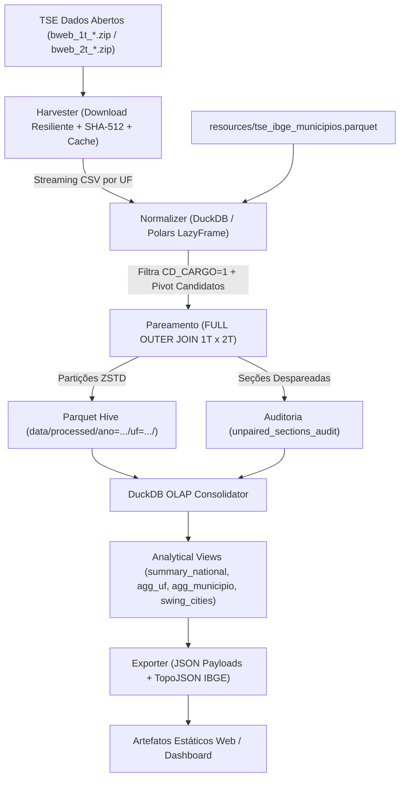

# SPECS.MD: Especificação Técnica Mestra e Arquitetura do Sistema

## 1. Escopo, Objetivos e Matriz de Requisitos

> [!IMPORTANT]
> **ESCOPO ELEITORAL ÚNICO, MANDATÓRIO E VINCULANTE (ELEIÇÕES 2026):**
> O sistema `virada_eleitoral` destina-se **exclusivamente à análise da Eleição Presidencial de 2026**, com foco soberano no **2º Turno ocorrido em 25/10/2026**, disputado entre os candidatos **Luiz Inácio Lula da Silva** (PT, 13) e **Flávio Bolsonaro** (PL, 22).
> Qualquer agente de IA ou desenvolvedor deve rejeitar premissas relativas a outros pleitos (como 2022). O ano de referência obrigatório de todo o pipeline, banco de dados, CLI e testes é `2026`.

Construir uma infraestrutura analítica de alta performance, auditável, reproduzível, multiplataforma (Windows/Linux/macOS) e baseada em processamento streaming para analisar os Boletins de Urna (BUs) de ambos os turnos das Eleições Presidenciais de 2026 (~470.000 a 500.000 seções eleitorais e mais de 40 milhões de linhas de registros brutos).

O objetivo central e primordial do projeto é quantificar determinística e matematicamente **como o candidato Luiz Inácio Lula da Silva construiu seu total de votos finais no 2º turno (25/10/2026)** em relação ao 1º turno, respondendo à pergunta fundamental: *de onde vieram os votos que Lula não tinha no primeiro turno?*
A decomposição contábil e estatística investiga exaustivamente:
1. Absorção de votos de eleitores de terceiros candidatos do 1º turno.
2. Absorção de eleitores que votaram em branco no 1º turno.
3. Absorção de eleitores que votaram nulo no 1º turno.
4. Absorção de novos eleitores decorrentes de variação no comparecimento / reversão de abstenções ($\Delta \text{Comparecimento}$).
5. Variação e virada frente ao seu oponente direto, **Flávio Bolsonaro** (22), consolidando resultados nos três níveis hierárquicos: Nacional/UF, Município e Seção Eleitoral.

---

### 1.1. Matriz de Requisitos de Alto Nível

| ID | Domínio | Requisito Resumido | Especificação Detalhada |
| :--- | :--- | :--- | :--- |
| `REQ-HARV-01` | Ingestão / Coleta | Obtenção streaming e gerência de pacotes de Boletins de Urna das Eleições 2026 (`bweb_1t_*.csv` e `bweb_2t_*.csv`) via download resiliente ou cache local. | [`specs/01-harvesting-and-manifest.md`](./specs/01-harvesting-and-manifest.md) |
| `REQ-HARV-02` | Integridade | Validação criptográfica de integridade de arquivo (`SHA-512`), controle de idempotência e manifesto formal de artefatos processados de 2026. | [`specs/01-harvesting-and-manifest.md`](./specs/01-harvesting-and-manifest.md) |
| `REQ-NORM-01` | Normalização | Filtragem estrita do cargo Presidente (`CD_CARGO == 1`), pivotagem de votos de Lula (13), Flávio Bolsonaro (22), terceiros, brancos e nulos e De-Para IBGE. | [`specs/02-normalization-and-pairing.md`](./specs/02-normalization-and-pairing.md) |
| `REQ-NORM-02` | Pareamento | Algoritmo de `FULL OUTER JOIN` sobre a chave canônica `(SG_UF, CD_MUNICIPIO, NR_ZONA, NR_SECAO)` entre 1º e 2º turnos (25/10/2026) sem distorção estatística. | [`specs/02-normalization-and-pairing.md`](./specs/02-normalization-and-pairing.md) |
| `REQ-NORM-03` | Auditoria de Seções | Detecção e rastreabilidade integral de urnas de contingência, agregadas ou ausentes em um dos turnos gravadas em `unpaired_sections_audit`. | [`specs/02-normalization-and-pairing.md`](./specs/02-normalization-and-pairing.md) |
| `REQ-ANAL-01` | Armazenamento | Persistência colunar em Parquet particionado (`ZSTD`) e consolidação idempotente em banco analítico DuckDB (`<= 150 MB`). | [`specs/03-analytics-and-turnover-metrics.md`](./specs/03-analytics-and-turnover-metrics.md) |
| `REQ-ANAL-02` | Fórmulas Analíticas | Cálculo exato de deltas nominais, deltas em pontos percentuais (`pp`), margem líquida e classificação categórica quádrupla de virada (Lula vs. Flávio Bolsonaro). | [`specs/03-analytics-and-turnover-metrics.md`](./specs/03-analytics-and-turnover-metrics.md) |
| `REQ-ANAL-03` | Decomposição e Migração | Modelagem exaustiva da construção dos votos de Lula no 2T: quantificação de absorção de terceiros candidatos, brancos, nulos e novos comparecentes. | [`specs/03-analytics-and-turnover-metrics.md`](./specs/03-analytics-and-turnover-metrics.md) |
| `REQ-ANAL-04` | Inferência Ecológica | Estimativa estatística da matriz de transição de votos (WLS / Goodman) sobre as seções eleitorais calibrada com os totais oficiais do TSE. | [`specs/03-analytics-and-turnover-metrics.md`](./specs/03-analytics-and-turnover-metrics.md) |
| `REQ-ANAL-05` | Saldo Líquido (Waterfall) | Cálculo dos degraus de saldo líquido da virada (saldo Lula - Flávio por grupo de origem) para decomposição exata de $\Delta \text{Margem}$. | [`specs/03-analytics-and-turnover-metrics.md`](./specs/03-analytics-and-turnover-metrics.md) |
| `REQ-EXPO-01` | Contratos JSON & Sankey | Exportação determinística de payloads JSON estáticos (resumos, cidades pêndulo e matriz/fluxo de migração Sankey) validados por Pydantic v2. | [`specs/04-export-geojson-and-web.md`](./specs/04-export-geojson-and-web.md) |
| `REQ-EXPO-02` | Cartografia IBGE | Cruzamento geográfico e fusão com malha territorial IBGE (GeoJSON/TopoJSON simplificado) para mapas temáticos de calor e virada de 2026. | [`specs/04-export-geojson-and-web.md`](./specs/04-export-geojson-and-web.md) |
| `REQ-EXPO-03` | Payloads dos 4 Pilares | Geração dos 4 contratos JSON mínimos de visualização: Waterfall, Sankey, Barras Empilhadas de Destino e Dispersão de Regressão. | [`specs/04-export-geojson-and-web.md`](./specs/04-export-geojson-and-web.md) |
| `REQ-EXPO-04` | Cartografia e Painéis Regionais | Geração de malhas TopoJSON e contratos para os 4 Pilares Cartográficos do MVP (Mapa Estadual, Mapa Municipal 5.570 cidades, Deep-Dive Sudeste SP/RJ/MG e Bolhas Ponderadas pelo Eleitorado $\Delta PP$). | [`specs/04-export-geojson-and-web.md`](./specs/04-export-geojson-and-web.md) |
| `REQ-QA-01` | Qualidade / SDD | Suíte de testes `pytest` cobrindo 10 fixtures áureas (`FX-01` a `FX-10`), testes de invariantes e CLI unificada (`virada`) com `--ano 2026`. | [`specs/05-testing-fixtures-and-roadmap.md`](./specs/05-testing-fixtures-and-roadmap.md) |

---

### 1.2. A Entrega Mínima do Produto (MVP Analítico e Visual): Os 4 Pilares Gráficos

Para cumprir a missão de jornalismo de dados eleitorais com rigor científico e clareza visual, o sistema tem como **entrega mínima obrigatória e inegociável** a produção dos dados para quatro representações analíticas fundamentadas no resultado oficial do TSE de 2026:

1. **Pilar 1: Gráfico em Cascata da Virada (Waterfall Chart de Saldo Líquido):**
   - **Pergunta respondida:** *Como Lula reverteu uma desvantagem de 2,22 milhões no 1T para uma vitória por 4,43 milhões no 2T?*
   - **Estrutura:** Ponto inicial no 1T (-2,22 mi), degraus de saldo líquido (votos captados por Lula menos votos captados por Flávio em cada grupo) e ponto final no 2T (+4,43 mi).
   - **Degraus:** Ex-brancos e nulos (+3,23 mi), Ausentes que voltaram (+1,83 mi), Saldo de retenção/perdas de base (+1,27 mi) e Terceiros candidatos (+0,32 mi).

2. **Pilar 2: Diagrama de Fluxo Aluvial / Sankey de Migração de Votos:**
   - **Pergunta respondida:** *De onde exatamente vieram todos os novos votos de Lula e de Flávio?*
   - **Estrutura:** Fluxo multivariado entre grupos de origem no 1T (Não votou, Branco/nulo, Outros candidatos, Perdas de Lula, Perdas de Flávio) e grupos de destino no 2T (Lula, Flávio, Branco/nulo, Não votou).

3. **Pilar 3: Matriz de Destino em Barras Horizontais Empilhadas (100% Stacked Bar):**
   - **Pergunta respondida:** *Qual foi a taxa percentual de atração e abstenção dentro de cada grupo decisivo do 1T?*
   - **Estrutura:** Três barras de distribuição (Lula, Flávio, Branco/nulo, Não votou) para:
     a) Eleitores de outros candidatos (consolidado e quebrado por candidato relevante: Cury, Caiado, Renan/Zema).
     b) Eleitores que votaram em branco ou nulo no 1T.
     c) Ausentes do 1T que retornaram para votar no 2T.

4. **Pilar 4: Dispersão e Reta de Regressão Seção a Seção (Scatter Plot + Trendline):**
   - **Pergunta respondida:** *Existe evidência empírica nas urnas de que onde havia mais brancos/nulos Lula cresceu mais?*
   - **Estrutura:** Eixo X (% de brancos e nulos no 1T sobre os aptos da seção), Eixo Y (Crescimento de Lula em pontos percentuais no 2T), nuvem de pontos de seções eleitorais e reta de tendência estimada por regressão linear ponderada (WLS), destacando a sensibilidade (ex.: `+0,8 pp para Lula a cada 1 pp de branco e nulo`).

---

### 1.3. O Segundo Componente do MVP: Sistema de Mapas e Análise Espacial Multinível (Os 4 Pilares Cartográficos)

Integrado e compondo a entrega mínima do produto, o sistema disponibiliza uma suíte cartográfica completa e responsiva que permite ao visitante explorar a geografia do voto do macro ao microdado:

1. **Geo-Pilar 1: Mapa Coroplético Estadual (Nacional por UF e DF):**
   - **Objetivo:** Exibir a divisão macro do país no 2º turno (UFs vencidas por Lula em vermelho vs vencidas por Flávio Bolsonaro em azul).
   - **Interatividade:** Tooltips com percentual de votos válidos, total de votos nominais e variação entre turnos de cada estado.

2. **Geo-Pilar 2: Mapa Coroplético de Alta Resolução Municipal (5.570 Cidades):**
   - **Objetivo:** Mapear o candidato mais votado em cada município brasileiro no 2º turno (Lula, Flávio ou Empate).
   - **Detecção de Viradas Locais (*Swing Cities*):** Filtro e realce imediato para cidades que mudaram de vencedor entre turnos.
   - **Card / Tooltip Comparativo 1T vs 2T:** Exibição do placar exato de ambos os turnos (exemplo canônico: *Nanuque/MG*, onde Flávio liderou o 1T com 48,54% x 46,87% e Lula virou no 2T com 51,33% x 48,67%).

3. **Geo-Pilar 3: Painel Comparativo dos Grandes Colégios Eleitorais (Deep-Dive Sudeste: SP, RJ e MG):**
   - **Objetivo:** Permitir ao usuário comparar lado a lado a mancha eleitoral municipal do 1T vs 2T em São Paulo, Minas Gerais e Rio de Janeiro.
   - **Gráficos Integrados de Avanço:** Barras comparativas de votos totais evidenciando que o avanço de Lula superou largamente o de Flávio Bolsonaro:
     * *São Paulo:* Lula cresceu +2.613.703 votos (9,50 mi -> 12,11 mi) vs Flávio +1.217.046 (12,92 mi -> 14,13 mi).
     * *Minas Gerais:* Lula cresceu +1.043.413 votos (5,18 mi -> 6,23 mi) vs Flávio +554.045 (5,77 mi -> 6,33 mi).
     * *Rio de Janeiro:* Lula cresceu +872.265 votos (3,69 mi -> 4,56 mi) vs Flávio +202.058 (4,96 mi -> 5,16 mi).

4. **Geo-Pilar 4: Mapa de Bolhas Proporcionais de Avanço de Lula ($\Delta PP$ Ponderado pelo Eleitorado):**
   - **Objetivo:** Evidenciar visualmente onde ocorreu a maior intensidade de migração de votos para Lula no território nacional.
   - **Estrutura:** Círculos proporcionais ao eleitorado apto municipal com preenchimento em escala cromática contínua (de 0 pp / estável até $\ge +10\text{ pp}$ / maior avanço relativo).
   - **Destaque das Capitais Estratégicas:** Callouts georreferenciados para as principais metrópoles:
     * São Paulo (+8,9 pp), Salvador (+8,0 pp), Belo Horizonte (+7,8 pp), Rio de Janeiro (+7,6 pp), Brasília (+7,6 pp), Curitiba (+7,3 pp), Porto Alegre (+7,3 pp), Belém (+7,0 pp), Manaus (+7,0 pp), Fortaleza (+6,6 pp), Recife (+6,0 pp).

---

## 2. Semântica Eleitoral e Regras de Negócio Fundamentais

### 2.1. Chave Canônica de Pareamento
A unidade atômica territorial e soberana de auditoria é a **Seção Eleitoral**, identificada exclusivamente pela tupla quádrupla:
$$\text{PK} = (\text{SG\_UF}, \text{CD\_MUNICIPIO}, \text{NR\_ZONA}, \text{NR\_SECAO})$$

- `SG_UF`: Sigla da Unidade Federativa (2 caracteres maiúsculos: 26 estados + `DF` + `ZZ` para votação no exterior).
- `CD_MUNICIPIO`: Código de município adotado pela Justiça Eleitoral (TSE), com 5 dígitos numéricos.
- `NR_ZONA`: Número da Zona Eleitoral.
- `NR_SECAO`: Número da Seção Eleitoral.

### 2.2. Definições e Fórmulas de Métricas Analíticas
Para cada entidade territorial (Seção, Município, UF ou Brasil) e turnos $T \in \{1, 2\}$:

1. **Votos Válidos ($V_T$):** Total de votos nominais em candidatos habilitados:
   $$V_T = \text{Votos}_{\text{Lula}, T} + \text{Votos}_{\text{Adversário}, T} + \text{Votos}_{\text{Outros}, T}$$
   *(No 2º turno, $\text{Votos}_{\text{Outros}, 2T} = 0$ por definição regulamentar).*

2. **Percentual de Votos Válidos ($P_{C, T}$):**
   $$P_{C, T} = \frac{\text{Votos}_{C, T}}{V_T} \times 100$$
   *(Calculado estritamente com tratamento de divisão por zero: `COALESCE(votos * 100.0 / NULLIF(v_validos, 0), 0.0)`).*

3. **Delta Nominal de Lula ($\Delta \text{Votos}_{13}$):**
   $$\Delta \text{Votos}_{13} = \text{Votos}_{13, 2T} - \text{Votos}_{13, 1T}$$

4. **Delta em Pontos Percentuais ($\Delta PP_{13}$):**
   $$\Delta PP_{13} = P_{13, 2T} - P_{13, 1T}$$

5. **Margem Líquida ($M_T$) e Delta de Margem ($\Delta M$):**
   $$M_T = \text{Votos}_{13, T} - \text{Votos}_{\text{Adv}, T}$$
   $$\Delta M = M_{2T} - M_{1T}$$

6. **Classificação Categórica do Resultado:**
   Avaliada comparando os votos do candidato Lula (13) frente ao adversário Flávio Bolsonaro (22) em cada turno:
   - **`VIRADA_LULA`:** $\text{Votos}_{13, 1T} < \text{Votos}_{22, 1T}$ E $\text{Votos}_{13, 2T} > \text{Votos}_{22, 2T}$.
   - **`VIRADA_ADVERSARIO`:** $\text{Votos}_{13, 1T} > \text{Votos}_{22, 1T}$ E $\text{Votos}_{13, 2T} < \text{Votos}_{22, 2T}$.
   - **`MANTEVE_LIDERANCA`:** $\text{Votos}_{13, 1T} > \text{Votos}_{22, 1T}$ E $\text{Votos}_{13, 2T} > \text{Votos}_{22, 2T}$.
   - **`MANTEVE_DESVANTAGEM`:** $\text{Votos}_{13, 1T} < \text{Votos}_{22, 1T}$ E $\text{Votos}_{13, 2T} < \text{Votos}_{22, 2T}$.
   - *(Em empates exatos $\text{Votos}_{13} == \text{Votos}_{22}$, registra-se `EMPATE_1T` ou `EMPATE_2T`).*

7. **Decomposição Analítica da Construção dos Votos de Lula no 2º Turno:**
   - Para explicar matematicamente como Lula totalizou seus votos no 2º turno, decompõe-se o ganho líquido de votos ($\Delta \text{Votos}_{13}$) em relação ao reservatório potencial de votos disponíveis do 1T:
     $$\text{Pool}_{\text{Disponível}} = \text{Votos}_{\text{Outros}, 1T} + \Delta \text{Brancos} + \Delta \text{Nulos} + \max(0, \Delta \text{Comparecimento})$$
     onde:
     - $\Delta \text{Brancos} = \max(0, \text{Votos}_{\text{Brancos}, 1T} - \text{Votos}_{\text{Brancos}, 2T})$ (votos em branco convertidos em votos nominais).
     - $\Delta \text{Nulos} = \max(0, \text{Votos}_{\text{Nulos}, 1T} - \text{Votos}_{\text{Nulos}, 2T})$ (votos nulos convertidos em votos nominais).
     - $\Delta \text{Comparecimento} = \text{Comparecimento}_{2T} - \text{Comparecimento}_{1T}$ (eleitores ausentes no 1T que compareceram às urnas no 25/10/2026).
   - A modelagem quantifica a contribuição relativa de cada uma dessas quatro fontes para o total final $\text{Votos}_{13, 2T}$, alimentando o diagrama de fluxo Sankey/Waterfall.

---

## 3. Insumos Primários dos Boletins de Urna (TSE)

Os dados provêm dos arquivos oficiais de votação nominal por seção do TSE para as Eleições Presidenciais de 2026 (`bweb_1t_{UF}_*.csv` e `bweb_2t_{UF}_*.csv`), contendo codificação `ISO-8859-1` e separador `;`:

| Coluna Original TSE | Tipo de Dado | Descrição e Uso no Pipeline |
| :--- | :--- | :--- |
| `SG_UF` | `VARCHAR(2)` | Sigla do Estado (`SP`, `MG`, ..., `ZZ`). |
| `CD_MUNICIPIO` | `INTEGER` | Código do município no TSE (5 dígitos). |
| `NM_MUNICIPIO` | `VARCHAR(120)`| Nome oficial do município. |
| `NR_ZONA` | `SMALLINT` | Número da Zona Eleitoral. |
| `NR_SECAO` | `SMALLINT` | Número da Seção Eleitoral. |
| `CD_CARGO` | `TINYINT` | Código do cargo em disputa (`1` = Presidente). |
| `NR_VOTAVEL` | `INTEGER` | Número do candidato (`13` Lula, `22` Flávio Bolsonaro, outros, `95` Branco, `96` Nulo). |
| `QT_VOTOS` | `INTEGER` | Quantidade de votos apurados naquela linha. |
| `QT_APTOS` | `INTEGER` | Quantidade de eleitores aptos na seção. |
| `QT_COMPARECIMENTO`| `INTEGER` | Total de eleitores que compareceram à urna. |
| `QT_ABSTENCAO` | `INTEGER` | Total de eleitores que se abstiveram. |

---

## 4. Arquitetura de Dados Colunar e DDL do DuckDB

### 4.1. Tabela Granular de Seções Pareadas (`pair_sections`)
Consolidada no DuckDB com chave primária composta:

```sql
CREATE TABLE pair_sections (
    ano_eleicao SMALLINT NOT NULL,
    sg_uf VARCHAR(2) NOT NULL,
    cd_municipio INTEGER NOT NULL,
    cd_municipio_ibge INTEGER,                   -- Enriquecido via De-Para (7 dígitos)
    nm_municipio VARCHAR(120) NOT NULL,
    nr_zona SMALLINT NOT NULL,
    nr_secao SMALLINT NOT NULL,
    status_pareamento VARCHAR(20) NOT NULL,      -- 'PAREADA_AMBOS', 'APENAS_1T', 'APENAS_2T'
    
    -- Turno 1
    aptos_1t INTEGER,
    comparecimento_1t INTEGER,
    abstencao_1t INTEGER,
    votos_validos_1t INTEGER,
    votos_lula_1t INTEGER NOT NULL DEFAULT 0,
    votos_adv_1t INTEGER NOT NULL DEFAULT 0,
    votos_outros_1t INTEGER NOT NULL DEFAULT 0,
    votos_brancos_1t INTEGER NOT NULL DEFAULT 0,
    votos_nulos_1t INTEGER NOT NULL DEFAULT 0,
    pct_lula_1t DOUBLE NOT NULL DEFAULT 0.0,
    pct_adv_1t DOUBLE NOT NULL DEFAULT 0.0,
    
    -- Turno 2
    aptos_2t INTEGER,
    comparecimento_2t INTEGER,
    abstencao_2t INTEGER,
    votos_validos_2t INTEGER,
    votos_lula_2t INTEGER NOT NULL DEFAULT 0,
    votos_adv_2t INTEGER NOT NULL DEFAULT 0,
    votos_brancos_2t INTEGER NOT NULL DEFAULT 0,
    votos_nulos_2t INTEGER NOT NULL DEFAULT 0,
    pct_lula_2t DOUBLE NOT NULL DEFAULT 0.0,
    pct_adv_2t DOUBLE NOT NULL DEFAULT 0.0,
    
    -- Métricas Analíticas de Virada
    delta_votos_lula INTEGER NOT NULL DEFAULT 0,
    delta_votos_adv INTEGER NOT NULL DEFAULT 0,
    delta_pp_lula DOUBLE NOT NULL DEFAULT 0.0,
    delta_pp_adv DOUBLE NOT NULL DEFAULT 0.0,
    margem_1t INTEGER NOT NULL DEFAULT 0,
    margem_2t INTEGER NOT NULL DEFAULT 0,
    delta_margem INTEGER NOT NULL DEFAULT 0,
    delta_abstencao INTEGER NOT NULL DEFAULT 0,
    classificacao_virada VARCHAR(30) NOT NULL,    -- 'VIRADA_LULA', 'VIRADA_ADVERSARIO', 'MANTEVE_LIDERANCA', 'MANTEVE_DESVANTAGEM'
    eficiencia_absorcao_outros DOUBLE,
    
    PRIMARY KEY (ano_eleicao, sg_uf, cd_municipio, nr_zona, nr_secao)
);
```

### 4.2. Tabela de Auditoria de Seções Não-Pareadas (`unpaired_sections_audit`)
Registra seções com contingência, quebra de urna, agregação ou seções prisionais/itinerantes existentes em apenas um dos turnos:

```sql
CREATE TABLE unpaired_sections_audit (
    ano_eleicao SMALLINT NOT NULL,
    sg_uf VARCHAR(2) NOT NULL,
    cd_municipio INTEGER NOT NULL,
    nm_municipio VARCHAR(120) NOT NULL,
    nr_zona SMALLINT NOT NULL,
    nr_secao SMALLINT NOT NULL,
    turno_presente TINYINT NOT NULL,             -- 1 ou 2
    motivo_detectado VARCHAR(50) NOT NULL,       -- 'SECAO_AGREGADA', 'URNA_CONTINGENCIA_NAO_PAREADA', 'DIVERGENCIA_TRE'
    total_votos_apurados INTEGER NOT NULL,
    recorded_at TIMESTAMP NOT NULL,
    PRIMARY KEY (ano_eleicao, sg_uf, cd_municipio, nr_zona, nr_secao, turno_presente)
);
```

### 4.3. Visões Analíticas Consolidadas (DuckDB)

1. **`summary_national`:** KPIs consolidados do Brasil (Totais de seções, eleitores, votos válidos 1T/2T, delta nominal nacional de Lula, deltas percentuais e contagem agregada de seções viradas).
2. **`agg_uf`:** Agregação estadual agrupada por `(ano_eleicao, sg_uf)` contendo totais de votos, margens, contagem de cidades e seções com virada de Lula vs. adversário.
3. **`agg_municipio`:** Agregação municipal agrupada por `(ano_eleicao, sg_uf, cd_municipio, cd_municipio_ibge, nm_municipio)` contendo a classificação de virada do município (`status_virada_municipio`), deltas, taxa de comparecimento e percentual de urnas viradas.
4. **`swing_cities`:** Cidades chave onde ocorreu virada formal (`status_virada_municipio IN ('VIRADA_LULA', 'VIRADA_ADVERSARIO')`), ordenadas pelo impacto nominal da virada (`ABS(delta_margem) DESC`).

---

## 5. Pipeline de Execução e Streaming



---

## 6. Invariantes Matemáticas Obrigatórias

Todo processamento em lote e suíte de testes deve validar rigorosamente as seguintes invariantes:
1. **Composição dos Votos Válidos:**
   $$\text{votos\_validos\_1t} = \text{votos\_lula\_1t} + \text{votos\_adv\_1t} + \text{votos\_outros\_1t}$$
   $$\text{votos\_validos\_2t} = \text{votos\_lula\_2t} + \text{votos\_adv\_2t}$$
2. **Conservação da Margem:**
   $$\text{delta\_margem} == \text{margem\_2t} - \text{margem\_1t} == (\text{delta\_votos\_lula} - \text{delta\_votos\_adv})$$
3. **Equivalência da Soma dos Deltas:**
   $$\Delta PP_{\text{Lula}} + \Delta PP_{\text{Adv}} + \Delta PP_{\text{Outros}} \approx 0 \quad (\pm 0.0001 \text{ por arredondamento})$$
4. **Idempotência de Agregação:**
   A soma de `votos_lula_1t` de todas as linhas de `agg_municipio` de uma UF deve ser rigorosamente idêntica a `votos_lula_1t` daquela UF em `agg_uf`.
5. **Classificação Determinística:**
   Não pode haver linha em `pair_sections` onde $\text{votos}_{13, 1T} < \text{votos}_{\text{adv}, 1T}$ e $\text{votos}_{13, 2T} > \text{votos}_{\text{adv}, 2T}$ cujo valor de `classificacao_virada` seja diferente de `VIRADA_LULA`.

---

## 7. Requisitos Não-Funcionais e SLAs de Desempenho

1. **Throughput de Processamento Streaming:**
   - O processamento completo dos ~40 milhões de linhas de registros de BUs dos 2 turnos para o Brasil inteiro deve ser concluído em **menos de 8 minutos** em máquina de 8 núcleos, utilizando `DuckDB` ou `Polars LazyFrame` com streaming sobre CSVs comprimidos.
2. **Teto de Consumo de Memória:**
   - O consumo residente de memória (RAM) durante o processamento de uma UF inteira (incluindo SP e MG) **não deve ultrapassar 8 GB**. Proibido carregar DataFrames Pandas sem paginação/streaming.
3. **Orçamento de Armazenamento:**
   - O banco consolidado DuckDB (`data/virada_eleitoral.duckdb`) **não deve ultrapassar 150 MB** para ambos os turnos das eleições gerais.
   - O payload JSON estático inicial (`summary_national.json` + `summary_uf.json`) não deve ultrapassar **200 KB** (sem compressão).
4. **Reprodutibilidade Estrita (*Byte-for-Byte*):**
   - Ordenação canônica explícita (`ORDER BY`) em todas as tabelas e views analíticas geradas, garantindo que execuções repetidas convirjam exatamente para o mesmo estado binário.
